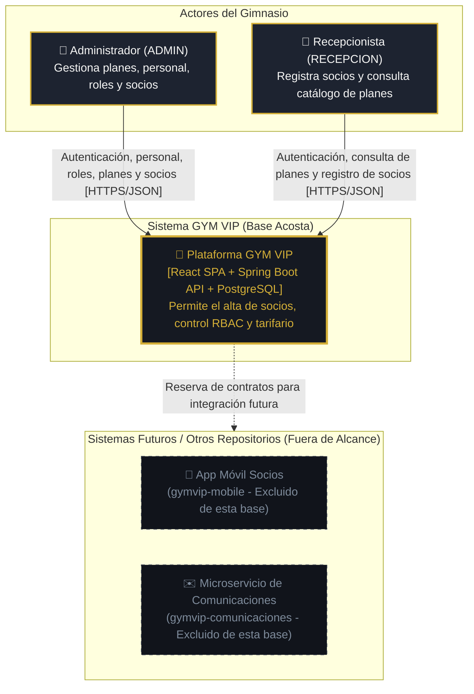
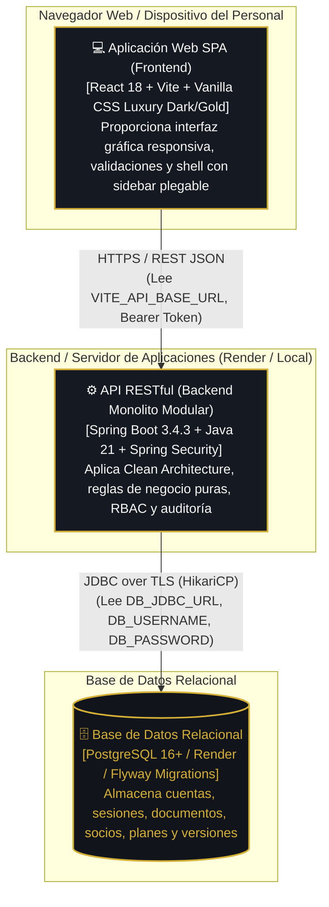

# Modelo de Arquitectura C4 — Base Funcional GYM VIP
**Responsable:** André Acosta (Sprint 1)  
**Alcance Técnico:** HU-01 (Registro de Clientes), HU-04 (Personal y Roles), HU-06 (Catálogo de Planes)  
**Fecha:** Octubre 2026  

---

## Nivel 1: Diagrama de Contexto del Sistema (C1)

Muestra los usuarios que interactúan con el sistema GYM VIP y sus fronteras operativas en la Base Sprint 1.



---

## Nivel 2: Diagrama de Contenedores (C2)

Describe la distribución de software ejecutable y sus protocolos de comunicación.



---

## Nivel 3: Diagrama de Componentes de Backend (C3 - Clean Architecture)

Ilustra la separación estricta entre capas y contextos del backend dentro del paquete raíz `com.gymvip`.

```mermaid
flowchart TB
    subgraph CapaAPI["Capa API / Web (Entrada HTTP & DTOs)"]
        AuthController["AuthController<br/>/api/v1/auth"]
        AccountController["AccountController<br/>/api/v1/accounts"]
        ClientController["ClientController<br/>/api/v1/clients"]
        PlanController["PlanController<br/>/api/v1/plans"]
        TokenAuthFilter["TokenAuthenticationFilter<br/>(Valida Bearer Token)"]
        GlobalExceptionAdvice["GlobalExceptionHandler<br/>(400, 401, 403, 404, 409)"]
    end

    subgraph CapaApplication["Capa Application (Casos de Uso & Puertos)"]
        subgraph InboundPorts["Puertos de Entrada (Interfaces)"]
            AuthUC["AuthUseCase"]
            StaffUC["StaffAccountUseCase"]
            ClientRegUC["RegisterClientUseCase"]
            ClientSearchUC["SearchClientsUseCase"]
            PlanUC["ManagePlanUseCase"]
            AuditUC["AuditUseCase"]
        end

        subgraph UseCaseServices["Implementación de Casos de Uso (Servicios de Aplicación)"]
            AuthService["AuthService"]
            StaffService["StaffAccountService"]
            ClientRegService["RegisterClientService"]
            ClientSearchService["SearchClientsService"]
            PlanService["ManagePlanService"]
            AuditService["AuditService"]
        end
    end

    subgraph CapaDomain["Capa Domain (Modelos Puros & Reglas Invariantes)"]
        AccountModel["Account / Session"]
        ClientModel["Client / Document / MemberCodeGenerator"]
        PlanModel["Plan / PlanVersion (Snapshot Inmutable)"]
        AuditModel["AuditEvent"]
        DomainExceptions["Domain Exceptions<br/>(ClientValidation, DuplicatePlan, LastAdminProtection, etc.)"]
    end

    subgraph CapaInfrastructure["Capa Infrastructure (Persistencia, Seguridad, Adaptadores)"]
        subgraph OutboundPorts["Puertos de Salida (Interfaces)"]
            AccountPort["AccountPersistencePort / SessionPersistencePort"]
            ClientPort["ClientPersistencePort"]
            PlanPort["PlanPersistencePort"]
            AuditPort["AuditPersistencePort"]
        end

        subgraph Adapters["Adaptadores de Persistencia & Repositorios Spring Data"]
            AccountAdapter["AccountPersistenceAdapter<br/>SpringDataAccountRepository"]
            ClientAdapter["ClientPersistenceAdapter<br/>SpringDataClientRepository<br/>SpringDataDocumentRepository"]
            PlanAdapter["PlanPersistenceAdapter<br/>SpringDataPlanRepository<br/>SpringDataPlanVersionRepository"]
            AuditAdapter["AuditPersistenceAdapter<br/>SpringDataAuditEventRepository"]
        end
    end

    %% Relaciones Capa API -> Application
    AuthController --> AuthUC
    AccountController --> StaffUC
    ClientController --> ClientRegUC
    ClientController --> ClientSearchUC
    PlanController --> PlanUC
    TokenAuthFilter --> AuthUC

    %% Relaciones Inbound Ports -> Services
    AuthUC <|.. AuthService
    StaffUC <|.. StaffService
    ClientRegUC <|.. ClientRegService
    ClientSearchUC <|.. ClientSearchService
    PlanUC <|.. PlanService
    AuditUC <|.. AuditService

    %% Relaciones Application -> Domain
    AuthService --> AccountModel
    StaffService --> AccountModel
    ClientRegService --> ClientModel
    ClientSearchService --> ClientModel
    PlanService --> PlanModel
    AuditService --> AuditModel
    UseCaseServices --> DomainExceptions

    %% Relaciones Application -> Outbound Ports
    AuthService --> AccountPort
    StaffService --> AccountPort
    ClientRegService --> ClientPort
    ClientSearchService --> ClientPort
    PlanService --> PlanPort
    AuditService --> AuditPort
    UseCaseServices --> AuditUC

    %% Relaciones Outbound Ports -> Infrastructure Adapters
    AccountPort <|.. AccountAdapter
    ClientPort <|.. ClientAdapter
    PlanPort <|.. PlanAdapter
    AuditPort <|.. AuditAdapter

    classDef apiLayer fill:#1D2330,stroke:#60A5FA,stroke-width:1px,color:#F5F5F4;
    classDef appLayer fill:#151922,stroke:#34D399,stroke-width:1px,color:#F5F5F4;
    classDef domainLayer fill:#11141B,stroke:#D4AF37,stroke-width:2px,color:#D4AF37;
    classDef infraLayer fill:#151922,stroke:#F59E0B,stroke-width:1px,color:#F5F5F4;

    class AuthController,AccountController,ClientController,PlanController,TokenAuthFilter,GlobalExceptionAdvice apiLayer;
    class AuthUC,StaffUC,ClientRegUC,ClientSearchUC,PlanUC,AuditUC,AuthService,StaffService,ClientRegService,ClientSearchService,PlanService,AuditService appLayer;
    class AccountModel,ClientModel,PlanModel,AuditModel,DomainExceptions domainLayer;
    class AccountPort,ClientPort,PlanPort,AuditPort,AccountAdapter,ClientAdapter,PlanAdapter,AuditAdapter infraLayer;
```
