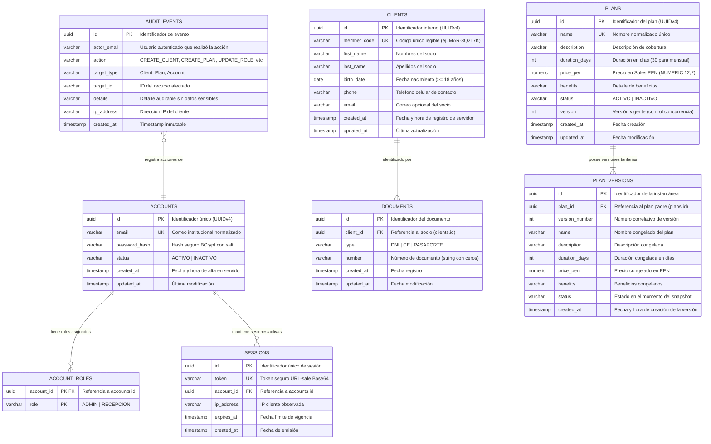

# Diagrama de Entidad-Relación de la Base Activa (ERD) — GYM VIP
**Responsable Base:** André Acosta (Sprint 1)  
**Motor:** PostgreSQL 16+ (Render / Local) / H2 compatibilidad PostgreSQL en dev  
**Estrategia de Migración:** Flyway (`V1__init_schema.sql`, `V2__add_member_code_to_clients.sql`) con `ddl-auto: validate`  

---

## 1. Modelo Entidad-Relación Activo (Mermaid)

---

## 2. Restricciones Físicas y Llaves Únicas Clave

| Tabla | Restricción / Índice | Columnas | Comportamiento / HU |
| :--- | :--- | :--- | :--- |
| `clients` | `uk_clients_member_code` (UNIQUE) | `member_code` | Garantiza unicidad del código de socio (`MAR-XXXXXX`). Reintento automático en generación. (HU-01) |
| `documents` | `uk_documents_type_number` (UNIQUE) | `type, number` | Unicidad documental compuesta en PostgreSQL. Devuelve HTTP 409 Conflict ante duplicados concurrentes. (HU-01) |
| `plans` | `uk_plans_name` (UNIQUE) | `LOWER(name)` | Impide registrar dos planes con el mismo nombre comercial. (HU-06) |
| `plan_versions` | `uk_plan_versions_plan_version` (UNIQUE) | `plan_id, version_number` | Asegura que cada versión de un plan sea única e inmutable en el tiempo. (HU-06) |
| `accounts` | `uk_accounts_email` (UNIQUE) | `email` | Correo institucional único para cada colaborador. (HU-04) |
| `sessions` | `uk_sessions_token` (UNIQUE) | `token` | Token único de sesión revocado inmediatamente ante cambio de rol o inactivación. (HU-04) |

---

## 3. Tablas Físicas Conservadas sin Uso Activo (Legacy / Roadmap Compañeros)

En cumplimiento estricto con la consigna de **no reescribir ni eliminar migraciones históricas** (`V1__init_schema.sql`) y **no ejecutar `DROP TABLE`**, las siguientes tablas físicas residen en el esquema PostgreSQL pero **NO forman parte del código activo de la base Acosta**:

1. `memberships`: Diseñada para asignación de membresías a clientes, suscripciones y renovaciones. Se transfiere limpia a los compañeros para el Sprint correspondiente.
2. `payment_records`: Diseñada para el registro de transacciones, pasarela y cobros.
3. `consents`: Conservada históricamente; la interfaz de alta de cliente ya no genera consentimientos legales ficticios (conforme a la última decisión de UX).
