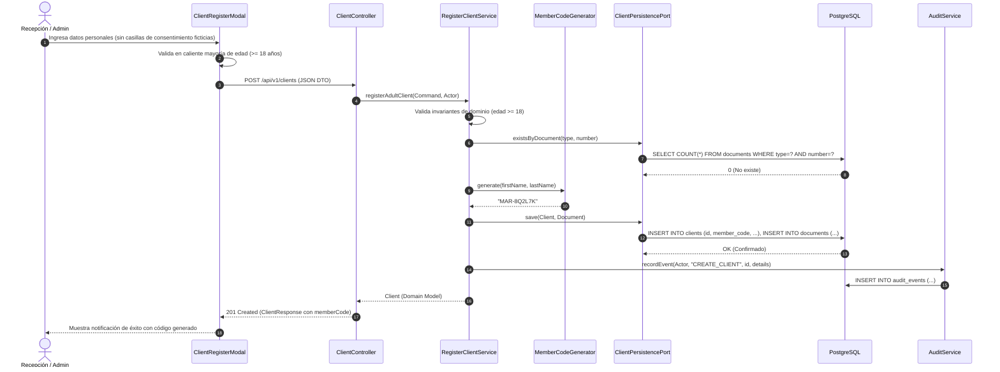
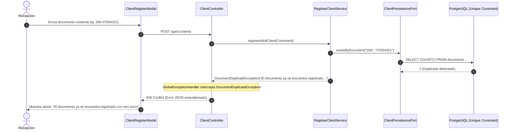
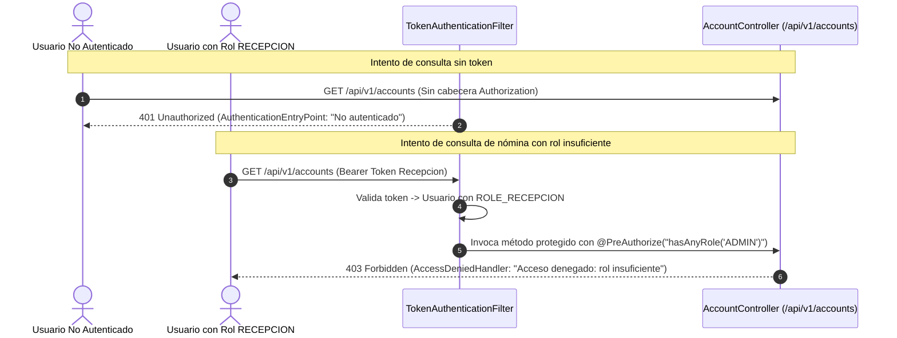
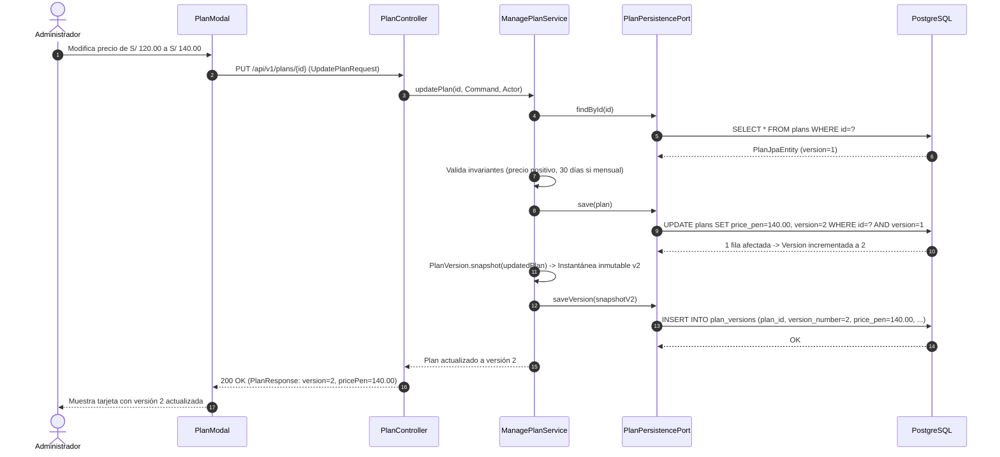
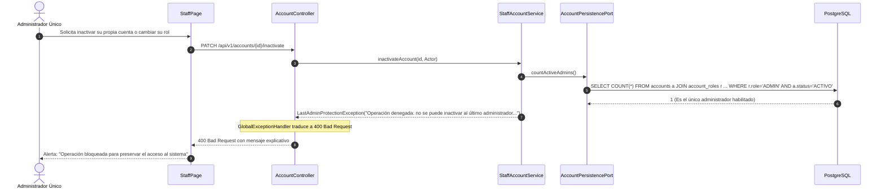
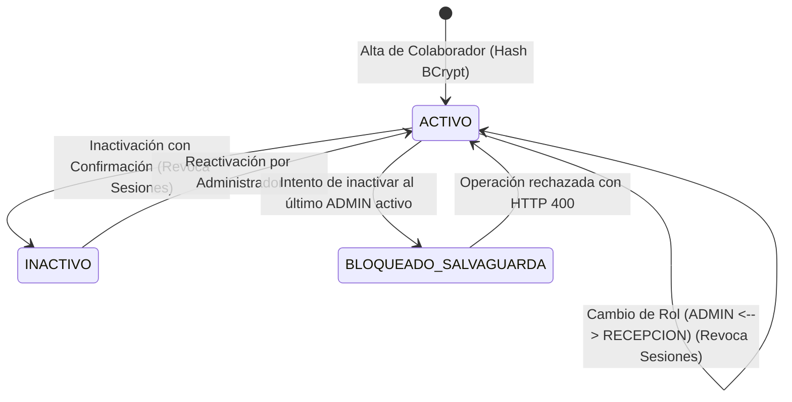
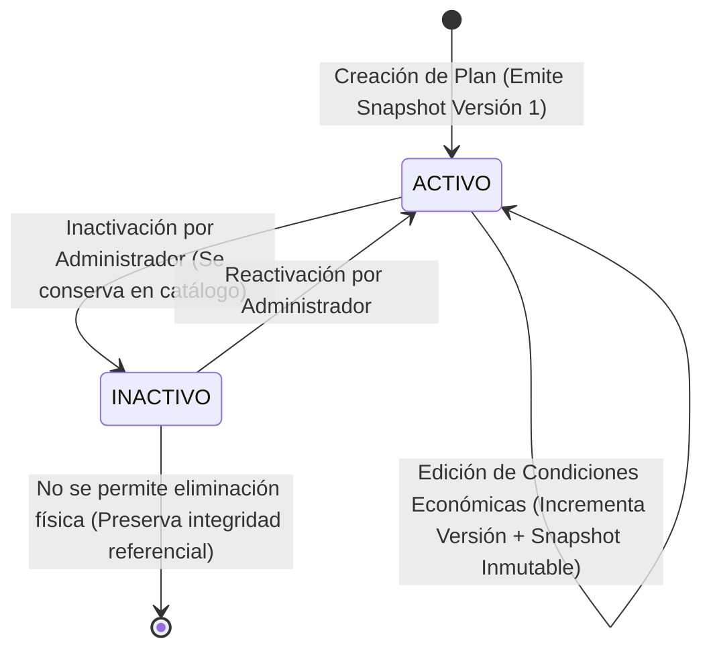

# Modelos y Dinámica del Negocio — Base Funcional GYM VIP
**Responsable:** André Acosta (Sprint 1)  
**Dominio:** Clientes (HU-01), Personal y Roles (HU-04), Planes y Tarifas (HU-06)  

---

## 1. Matriz de Trazabilidad Extremo a Extremo

| Historia de Usuario | Caso de Uso (Application) | Endpoint HTTP (API) | Componente UI (Frontend) | Tablas PostgreSQL | Pruebas Automatizadas |
| :--- | :--- | :--- | :--- | :--- | :--- |
| **HU-01: Registro de Clientes** | `RegisterClientUseCase` (`RegisterClientService`) | `POST /api/v1/clients` | `ClientRegisterModal.jsx` `ClientsPage.jsx` | `clients` `documents` `audit_events` | `ClientIntegrationTest` `registerAdultClientSuccess` `registerMinorClientBlocked` Unicidad 409 |
| **HU-01: Consulta de Clientes** | `SearchClientsUseCase` (`SearchClientsService`) | `GET /api/v1/clients` `GET /api/v1/clients/{id}` | `ClientsPage.jsx` `ClientDetailModal.jsx` | `clients` `documents` | `ClientIntegrationTest` Ficha de socio `MAR-XXXXXX` |
| **HU-04: Nómina de Personal** | `StaffAccountUseCase` (`StaffAccountService`) | `GET /api/v1/accounts` | `StaffPage.jsx` | `accounts` `account_roles` | `AccountManagementIntegrationTest` `adminCanListAccounts` `recepcionForbiddenFromAccounts` (403) |
| **HU-04: Alta de Personal** | `StaffAccountUseCase` (`StaffAccountService`) | `POST /api/v1/accounts` | `StaffModal.jsx` | `accounts` `account_roles` `audit_events` | `AccountManagementIntegrationTest` `adminCanCreateNewStaffMember` (BCrypt hash) |
| **HU-04: Asignación de Rol** | `StaffAccountUseCase` (`StaffAccountService`) | `PATCH /api/v1/accounts/{id}/role` | `StaffPage.jsx` (Modal Rol) | `account_roles` `sessions` `audit_events` | `AccountManagementIntegrationTest` `adminCanUpdateStaffRole` (Revoca sesiones) |
| **HU-04: Protección Último Admin**| `StaffAccountUseCase` (`StaffAccountService`) | `PATCH /api/v1/accounts/{id}/role` `PATCH /api/v1/accounts/{id}/inactivate` | `StaffPage.jsx` (Confirmación) | `accounts` `account_roles` | `AccountManagementIntegrationTest` `cannotDemoteLastAdmin` `cannotInactivateLastAdmin` (HTTP 400) |
| **HU-06: Catálogo de Planes** | `ManagePlanUseCase` (`ManagePlanService`) | `GET /api/v1/plans` `GET /api/v1/plans/{id}` | `PlansPage.jsx` | `plans` `plan_versions` | `PlanIntegrationTest` `recepcionCanListPlans` `adminCanCreateAndListPlan` |
| **HU-06: Creación de Plan** | `ManagePlanUseCase` (`ManagePlanService`) | `POST /api/v1/plans` | `PlanModal.jsx` `PlansPage.jsx` | `plans` `plan_versions` (v1) `audit_events` | `PlanIntegrationTest` `adminCanCreateAndListPlan` `recepcionCannotCreatePlan` (403) Regla 30 días mensual |
| **HU-06: Edición y Versión** | `ManagePlanUseCase` (`ManagePlanService`) | `PUT /api/v1/plans/{id}` | `PlanModal.jsx` | `plans` (versión + 1) `plan_versions` (vN snapshot) `audit_events` | `PlanIntegrationTest` `updatePlanIncrementsVersionAndInactivates` |
| **HU-06: Control de Estado** | `ManagePlanUseCase` (`ManagePlanService`) | `PATCH /api/v1/plans/{id}/status` | `PlansPage.jsx` (Confirmar Inactivar) | `plans` `audit_events` | `PlanIntegrationTest` Cambio de estado a `INACTIVO` |

---

## 2. Diagramas de Secuencia Clave

### Secuencia 1: Registro Exitoso de Socio con Generación de Código Único (HU-01)

---

### Secuencia 2: Rechazo por Documento Duplicado Concurrente (HU-01 - 409 Conflict)

---

### Secuencia 3: Control de Acceso RBAC (HU-04 - 401 y 403)

---

### Secuencia 4: Edición de Plan Tarifario e Instantánea Inmutable (HU-06)

---

### Secuencia 5: Protección Contra Inactivación del Último Administrador (HU-04)

---

## 3. Máquinas de Estado

### Estado de Cuenta de Personal (HU-04)

### Estado de Plan y Ciclo de Vida Tarifario (HU-06)

