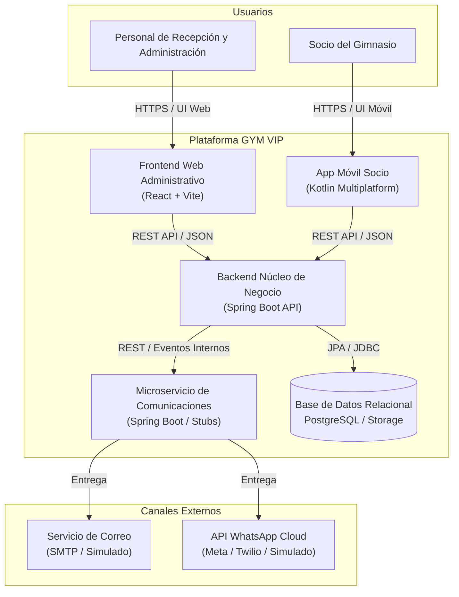

# Arquitectura de Software Canónica — GYM VIP

**Versión:** 1.0 — 11 de octubre de 2026  
**Sistema:** GYM VIP (VIP CENTER FIT S.A.C.)  
**Pila de tecnologías:**
- **Backend:** Java 21 / 24, Spring Boot 3.4.x, Spring Data JPA, Spring Security, Validation.
- **Persistencia:** PostgreSQL en producción; soporte para almacenamiento local durable en desarrollo.
- **Frontend Administrativo:** React 18/19, Vite, Vanilla CSS modular (Design System tokens).
- **Móvil del Socio:** Kotlin Multiplatform (KMP) enfocado en consulta (Android / iOS).
- **Comunicaciones:** Microservicio desacoplado con stubs para WhatsApp y Correo electrónico.

---

## 1. Visión General del Sistema y Límites de Contexto

El sistema GYM VIP centraliza el ciclo de vida de los clientes del gimnasio, la suscripción y renovación de membresías mediante cobros presenciales, y la consulta de estado por parte de los socios, reduciendo la fricción en recepción.



---

## 2. Organización Modular del Backend (Clean Architecture)

El backend de negocio se estructura en paquetes por contexto delimitado, manteniendo dentro de cada uno la separación de responsabilidades:

```
com.gymvip.core
├── identity              # Cuentas, credenciales, sesiones y tokens
│   ├── domain
│   ├── application
│   ├── infrastructure
│   └── api
├── clients               # Gestión de socios, documentos y consentimientos
│   ├── domain
│   ├── application
│   ├── infrastructure
│   └── api
├── plans                 # Catálogo de planes y versionado de condiciones
│   ├── domain
│   ├── application
│   ├── infrastructure
│   └── api
├── memberships           # Contratos, vigencias, snapshots y estados
│   ├── domain
│   ├── application
│   ├── infrastructure
│   └── api
├── payments              # Registro de pagos presenciales y trazabilidad
│   ├── domain
│   ├── application
│   ├── infrastructure
│   └── api
├── audit                 # Eventos de auditoría del sistema
│   ├── domain
│   ├── application
│   ├── infrastructure
│   └── api
└── shared                # Clases compartidas, excepciones, seguridad y utilitarios
    ├── exceptions
    ├── security
    └── config
```

### Reglas de Dependencia:
1. **Dominio (`domain`):** Entidades puras, objetos de valor e invariantes de negocio. No depende de frameworks web ni de detalles de persistencia.
2. **Aplicación (`application`):** Casos de uso y orquestación de servicios (`PlanService`, `ClientService`, etc.). Administra transacciones y reglas entre agregados.
3. **Infraestructura (`infrastructure`):** Repositorios JPA, adaptadores de persistencia, integración con clientes externos.
4. **API (`api`):** Controladores REST (`@RestController`), DTOs de entrada y salida (`Request/Response`), mapeadores y validaciones HTTP.

---

## 3. Principios de Persistencia e Integridad Transaccional

1. **Atomicidad Contrato-Cobro:** La asignación de una membresía (`Membership`) requiere obligatoriamente el registro simultáneo de su pago presencial (`PaymentRecord`) dentro de una transacción atómica (`@Transactional`). No existen membresías activas sin pago respaldado.
2. **Idempotencia:** Los endpoints mutables críticos (`/api/v1/memberships`) aceptan una cabecera `Idempotency-Key` (UUIDv4). Las solicitudes duplicadas con la misma clave devuelven la respuesta original sin recrear la transacción.
3. **Snapshot Inmutable:** Cada membresía almacena una copia inmutable (`MembershipTermsSnapshot`) de las condiciones, duración y precio acordados en el momento de la contratación, asegurando que cambios futuros en el plan no alteren contratos suscritos con anterioridad.
4. **Cálculo Determinístico de Vigencias:** El estado de vigencia se calcula en el dominio utilizando `LocalDate` con un reloj inyectado (`Clock`) configurado en zona horaria `America/Lima`.
5. **No Borrado Físico:** Las entidades críticas (clientes, planes, pagos, auditoría) implementan banderas de estado (`ACTIVO`, `INACTIVO`, `ANULADO`) o tablas de compensación.
