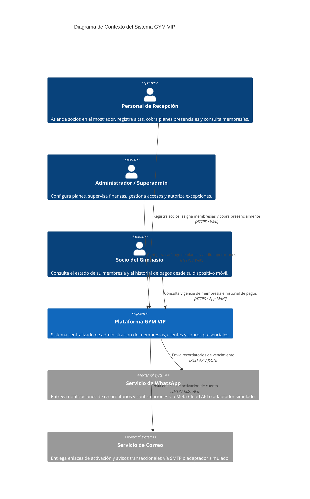
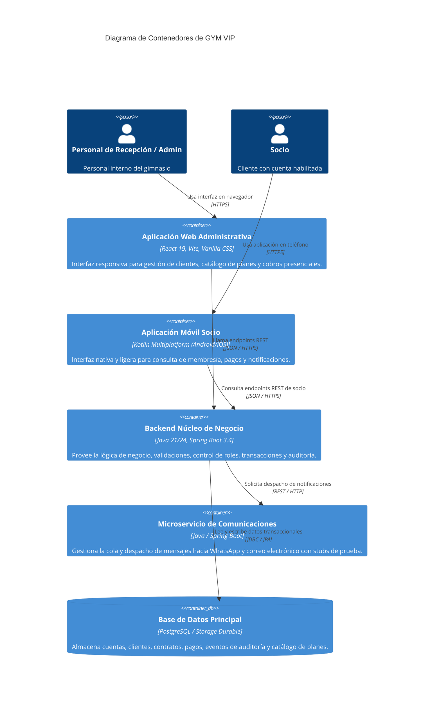

# Modelo C4 — Arquitectura de GYM VIP

**Niveles incluidos:** Nivel 1 (Contexto de Sistema), Nivel 2 (Contenedores) y Nivel 3 (Componentes del Backend Núcleo).

---

## Nivel 1: Diagrama de Contexto de Sistema (C1)

Describe a los usuarios clave y cómo interactúan con el ecosistema de software de VIP CENTER FIT frente a sistemas externos.



---

## Nivel 2: Diagrama de Contenedores (C2)

Muestra los subsistemas ejecutables independientes que componen GYM VIP.



---

## Nivel 3: Diagrama de Componentes del Backend (C3)

Desglose de los componentes lógicos que conforman el contenedor `Backend Núcleo de Negocio`.

```mermaid
C4Component
  title Diagrama de Componentes del Backend Núcleo

  Container_Boundary(api_boundary, "Spring Boot Core API")
    Component(auth_ctrl, "AuthController", "Spring REST Controller", "Expone login, logout y estado de sesión.")
    Component(client_ctrl, "ClientController", "Spring REST Controller", "Expone registro y búsqueda de socios adultos.")
    Component(plan_ctrl, "PlanController", "Spring REST Controller", "Expone alta, edición y consulta de planes.")
    Component(membership_ctrl, "MembershipController", "Spring REST Controller", "Expone asignación transaccional y consulta de vigencia.")

    Component(security_filter, "SecurityFilter & RBAC", "Spring Security", "Intercepta solicitudes, valida tokens/cookies y roles.")
    Component(audit_service, "AuditService", "Spring Service", "Registra eventos inmutables de auditoría.")

    Component(client_service, "ClientService", "Spring Service", "Gestiona reglas de clientes, unicidad y consentimientos.")
    Component(plan_service, "PlanService", "Spring Service", "Gestiona catálogo y versionado de planes.")
    Component(membership_service, "MembershipService", "Spring Service", "Orquesta transacción atómica de membresía y pago.")

    Component(db_repos, "JPA Repositories", "Spring Data JPA", "Acceso a tablas de base de datos.")
  end

  Rel(auth_ctrl, security_filter, "Valida credenciales")
  Rel(client_ctrl, client_service, "Delega lógica")
  Rel(plan_ctrl, plan_service, "Delega lógica")
  Rel(membership_ctrl, membership_service, "Delega lógica")

  Rel(client_service, audit_service, "Emite evento")
  Rel(membership_service, audit_service, "Emite evento")

  Rel(client_service, db_repos, "Persiste socios")
  Rel(plan_service, db_repos, "Persiste planes")
  Rel(membership_service, db_repos, "Persiste contratos y pagos")
```
