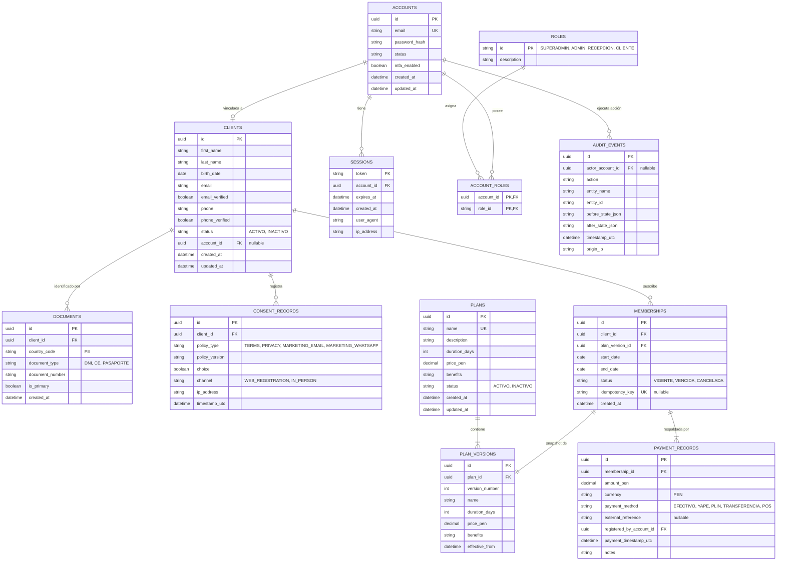

# Diagrama Entidad-Relación (ERD) — GYM VIP

**Motor:** PostgreSQL / Esquema Relacional  
**Convención:** Claves primarias autoincrementales o UUIDs; columnas en `snake_case`; índices únicos para restricciones de negocio.

---

## Diagrama Lógico y Físico (Mermaid)

---

## Restricciones Clave de Integridad

1. **Unicidad de Documento de Identidad:**
   `CREATE UNIQUE INDEX uk_document_per_country ON documents (country_code, document_type, document_number);`
   Garantiza que ningún cliente pueda registrarse duplicando un DNI o Pasaporte.
2. **Unicidad de Nombre de Plan:**
   `CREATE UNIQUE INDEX uk_plan_name ON plans (LOWER(name));`
   Evita planes con el mismo nombre comercial.
3. **Idempotencia de Membresía:**
   `CREATE UNIQUE INDEX uk_membership_idempotency ON memberships (idempotency_key);`
   Protege contra el doble cobro o doble creación por pulsaciones repetidas o reintentos de red.
4. **No Nulidad Financiera:**
   `CHECK (price_pen > 0 AND duration_days > 0)` en planes.
   `CHECK (amount_pen > 0)` en registros de pago.
